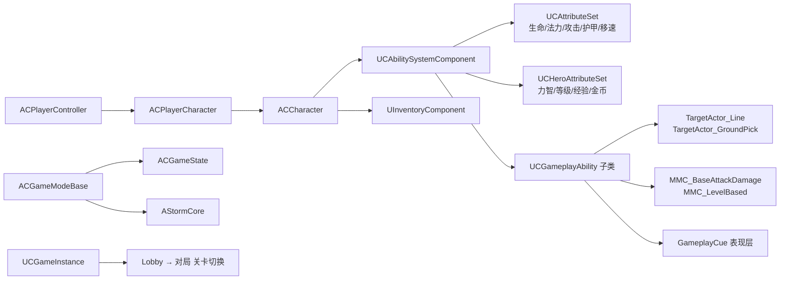

# Crunch · 5v5 MOBA

> 使用 Unreal Engine 5.4 与 Gameplay Ability System（GAS）从零搭建的 5v5 多人在线战术竞技 Demo。玩法逻辑全部写在 C++ 中，蓝图只负责资源与表现层装配。


[](https://www.bilibili.com/video/BV1Tf4w6REow)

---

## 项目简介

Crunch 是一个以 Dota 类玩法为目标的多人项目：双方各 5 名英雄，配兵线、防御塔核心（`AStormCore`）、商店与装备合成，流程从 Lobby 选人无缝进入对局。

代码规模约 **160 个源文件、9,900 行 C++**，按职责拆成 9 个模块：

| 模块 | 文件数 | 职责 |
| --- | --- | --- |
| `GAS/` | 42 | 技能、属性、目标选择、伤害计算、GameplayCue |
| `Widgets/` | 64 | UMG 控件：HUD、商店、背包、计分板、Lobby |
| `Framework/` | 12 | GameMode / GameState / GameInstance / AssetManager / StormCore |
| `Player/` | 12 | PlayerController、PlayerState、选人与队伍信息 |
| `AI/` | 8 | AIController、小兵、兵营、行为树任务 |
| `Animations/` | 6 | AnimInstance、动画通知（发送 GameplayEvent / 目标组） |
| `Inventory/` | 6 | 背包组件、物品、商店条目、合成 |
| `Character/` | 4 | 角色基类、英雄定义数据资产 |
| `NetWork/` | 2 | 网络相关的静态工具函数 |


## 演示

▶ **演示视频（Bilibili）**：<https://www.bilibili.com/video/BV1Tf4w6REow>

> GitHub 不支持内嵌 B 站播放器，点击链接观看完整对局演示。
## 技术栈

- **引擎**：Unreal Engine 5.4，C++ 模块名 `Crunch`，`Crunch.Target.cs` / `CrunchEditor.Target.cs` 双 Target
- **技能与属性**：Gameplay Ability System（`GameplayAbilities` + `GameplayTasks` + `GameplayTags`）
- **输入**：Enhanced Input
- **UI**：UMG + Slate
- **AI**：AIModule（AIPerception + 行为树任务）
- **表现**：Niagara、GameplayCue
- **网络**：服务端权威（`Server RPC` + 属性复制 + `ReplicatedUsing`）

## 架构总览



`ACCharacter` 同时实现三个接口：`IAbilitySystemInterface`（技能系统入口）、`IGenericTeamAgentInterface`（敌我关系）、`IRenderActorTargetInterface`（UI 里渲染角色立绘）。

## 核心系统

### 1. 技能系统（GAS）

- `UCGameplayAbility` 作为所有技能的基类，统一封装了瞄准拾取（`GetAimTarget`）、球形扫掠命中判定（`GetHitResultFromSweepLocationTargetData`）、击退（`PushSelf` / `PushTargets`）、蒙太奇控制以及**基于阵营的敌我过滤**（`IsActorTeamAttitudeIs`）。
- 技能按输入槽位注册：`ECAbilityInputID` 定义了 `BasicAttack`、`Aim`、`AbilityOne` … `AbilitySix`、`Confirm`、`Cancel`，`UCAbilitySystemComponent` 内部用 `TMap<ECAbilityInputID, TSubclassOf<UGameplayAbility>>` 存放**技能**与**基础能力**两套映射。
- 技能升级走服务端 RPC，客户端收到等级刷新后再更新 UI：

```cpp
UFUNCTION(Server, Reliable, WithValidation)
void Server_UpgradeAbilityWithID(ECAbilityInputID InputID);

UFUNCTION(Client, Reliable)
void Client_AbilitySpecLevelUpdated(FGameplayAbilitySpecHandle Handle, int NewLevel);
```

- 目标选择抽象成 `TargetActor`：`TargetActor_Line` 走直线（适合穿透/直线技能），`TargetActor_GroundPick` 走地面选点（适合圆形范围技能），`ATA_Blackhole` 处理持续吸附。
- 伤害不走硬编码，用 `MMC_BaseAttackDamage`、`MMC_LevelBased` 这类 `ModMagnitudeCalculation` 根据属性与等级动态算。

已实现的技能（`GA_*`）：

| 技能 | 类 | 关键点 |
| --- | --- | --- |
| 普攻 | `UGA_Shoot` | 投射物 + `ability.shoot.hand_I / hand_r` 区分左右手 |
| 激光 | `UGA_Lazer` | 持续型，有独立的冷却与耗蓝结算 |
| 地面爆炸 | `UGA_GroundBlast` | 地面选点 + GameplayCue 表现 |
| 黑洞 | `UGA_Blackhole` | `ATA_Blackhole` 持续吸附，独立冷却 Tag |
| 连招 | `UGA_Combo` | 4 段连招，靠 `ability.combo.change.combo01~04` 推进 |
| 上勾拳 | `UUpperCut` | 击飞，配合 `UGAP_Launched` 处理被击飞状态 |

状态类能力单独拆成 `UGAP_*`（`UGAP_Dead`、`UGAP_Launched`），避免和主动技能混在一起。

### 2. 属性与成长

属性分成两层，各司其职：

- `UCAttributeSet`：战斗属性——生命、法力、攻击力、护甲、移速、加速度，外加 `CachedHealthPercent` / `CachedManaPercent` 供 UI 直接读百分比；在 `PreAttributeChange` / `PostGameplayEffectExecute` 里做钳制与死亡判定。
- `UCHeroAttributeSet`：成长属性——力量、智力、等级、经验、金币、技能点、成长率（`StrengthGrowthRate` 等），全部带 `ReplicatedUsing`。

英雄基础数值来自 `FHeroBaseStats`（`FTableRowBase`）的 DataTable：职业、力量、智力、成长率、基础生命/法力/攻击/护甲/移速一次性配置。

### 3. 角色状态机

`ACCharacter` 用 GameplayTag 驱动状态，而不是布尔开关：

- `DeathTagUpdated` → 死亡流程：播放死亡蒙太奇 → 延迟切换到布娃娃 → 复活
- `StunTagUpdated` → 眩晕蒙太奇与恢复
- `AimTagUpdated` / `FocusTagUpdated` → 瞄准与聚焦视角
- `MoveSpeedUpdated` / `MaxHealthUpdated` / `MaxManaUpdated` → 属性变化回调，直接驱动移动组件与 UI

头顶血条只对一定距离内的玩家显示（`HeadStatGaugeVisibilityRangeSquard` 用平方距离比较，省一次开方）。

### 4. AI 与兵线

- `ACAIController` 继承 `AAIController`，配合 `AIPerceptionStimuliSourceComponent` 让角色可被 AI 感知。
- `BTTask_SendInputToAbilitySystem` 是关键设计：**让 AI 通过和玩家相同的输入通道去触发 GAS 技能**，这样小兵和英雄共用一套技能释放逻辑，不用为 AI 重写一套。
- `AMinion` / `AMinionBarrack` 负责兵线单位与兵营的生成、推进。

### 5. 背包与商店

`UInventoryComponent` 是服务端权威的：

```cpp
UFUNCTION(Server, Reliable, WithValidation) void Server_Purchase(const UPA_ShopItem* ItemToPurchase);
UFUNCTION(Server, Reliable, WithValidation) void Server_ActivateItem(FInventoryItemHandle ItemHandle);
UFUNCTION(Server, Reliable, WithValidation) void Server_SellItem(FInventoryItemHandle ItemHandle);
```

- 6 格背包（`Capacity`），支持堆叠、拖拽换位（`ItemSlotChanged`）、合成（`TryItemCombination`）与材料查找（`FindIngredientForItem`）。
- 服务端改完状态后用 `Client_ItemAdded` / `Client_ItemRemoved` / `Client_ItemStackCountChanged` 三个 Reliable RPC 回推，UI 靠 `OnItemAdded` 等多播委托刷新，不做轮询。
- 商店条目是数据资产 `UPA_ShopItem`，价格、图标、合成配方都在资产里配置。

### 6. 网络与流程

- **Lobby → 对局**：`UCGameInstance` 持有三个关卡软引用（主菜单 / Lobby / 对局），选人结果缓存在 GameInstance 里，兼容 hard travel（PIE 默认，会重建 PlayerState）与 seamless travel 两种方式。
- **队伍与出生点**：`ACGameModeBase` 重写了 `ChoosePlayerStart_Implementation`，按 `TeamStartSpotTagMap` 为双方分配带队伍标记的 PlayerStart，并用 `TSet<TWeakObjectPtr<AActor>> UsedStartSpots` 记录已占用点——用**弱指针**是因为 GameMode 能在无缝切换中存活，强引用会把旧世界的 Actor 挂在内存里。
- **自定义碰撞通道**：`Target`（技能命中检测）与 `SpringArm`（相机），在 `DefaultEngine.ini` 里注册。
- **资源管理**：自定义 `CAssetManager` 通过 `AssetManagerClassName` 接管主资源加载。

### 7. UI 层

32 对 .h/.cpp，约 30 个 UMG 控件类，按用途分组：

- 数值条：`ValueGauge` / `StatsGauge` / `LevelGauge` / `AbilityGauge`，统一处理进度与数值绑定
- 对局 HUD：`GameplayWidget`、`CrosshairWidget`、`OverHeadStatsGauge`、`MatchStatWidget`
- 商店与背包：`ShopWidget`、`ShopItemWidget`、`InventoryWidget`、`InventoryItemWidget`、`ItemToolTip`、`InventoryContextMenuWidget`（拖拽用 `InventoryItemDragDropOp`）
- 流程界面：`LobbyWidget`、`TeamSelectionWidget`、`CharacterDisplay`（用 `RenderActorWidget` 在 UI 里渲染 3D 角色模型）、`GameplayMenu`

## 目录结构

```
Crunch/
├── Config/                  # Engine / Game / GameplayTags / Input / Editor 配置
├── Source/
│   ├── Crunch/              # 主模块
│   │   ├── Private/
│   │   │   ├── AI/          Animations/   Character/   Framework/
│   │   │   ├── GAS/         Inventory/    NetWork/     Player/     Widgets/
│   │   │   └── ...
│   │   ├── Crunch.Build.cs
│   │   └── Crunch.h / .cpp
│   ├── Crunch.Target.cs
│   └── CrunchEditor.Target.cs
├── Crunch.uproject          # UE 5.4，启用 GameplayAbilities 插件
└── Crunch.sln
```

## 本地运行

```bash
# 1. 需要 Unreal Engine 5.4 与 Visual Studio 2022（含 C++ 游戏开发工作负载）
# 2. 生成工程文件
右键 Crunch.uproject → Generate Visual Studio project files

# 3. 编译（或直接用编辑器触发编译）
# 4. 打开 Crunch.uproject，编辑器启动地图为 /Game/Maps/GameLevel
```

**注意**：本仓库只包含 C++ 源码与配置，`Content/`（约 4 GB 的美术资源）未入库，克隆后无法直接运行。原因见下节。

## 关于本仓库

- `Content/`、`Binaries/`、`Intermediate/`、`Saved/`、`.vs/` 全部通过 `.gitignore` 排除：
  - `Content/` 约 4.1 GB，远超 GitHub 的单文件 100 MB 与仓库建议的 1 GB 上限；
  - 其余为编译产物与本地缓存，可由源码重建。
- 因此本仓库的定位是**代码作品集**：可以直接阅读 GAS 接入方式、网络 RPC 设计、AI 与 UI 的组织方式。
- 若需要可运行的完整工程，欢迎通过 Issue 或邮件联系。

## 已知限制

- 美术资源未入库，无法开箱运行。
- 部分系统仍在迭代：AI 行为树的决策分支、装备主动技能的通用化、结算界面。

## 致谢

玩法框架与技能设计参考了 Epic 官方 GAS 文档以及社区公开教程的实现思路，在此基础上完成了网络流程、AI 输入通道、背包商店与 UI 层的二次开发。

---

如果这个项目对你有帮助，欢迎 Star ⭐
